# Coffee Shop: architecture and features

Diagrams of how the code is organised and what the app can do. The [README](README.md) explains
how to run it and how to add a feature.

GitHub, GitLab and IntelliJ (with the Mermaid plugin) render the diagrams below.

## Contents

1. [Runtime: the parts and how they talk](#1-runtime-the-parts-and-how-they-talk)
2. [Packages and their relationships](#2-packages-and-their-relationships)
3. [Inside each package](#3-inside-each-package)
   - [common](#common)
   - [catalog](#catalog)
   - [customer](#customer)
   - [cart](#cart)
   - [order](#order)
4. [Database: foreign keys inside a feature, ids across](#4-database-foreign-keys-inside-a-feature-ids-across)
5. [Checkout, step by step](#5-checkout-step-by-step)
6. [Frontend modules](#6-frontend-modules)
7. [Features: use cases and user stories](#7-features-use-cases-and-user-stories)

---

## 1. Runtime: the parts and how they talk

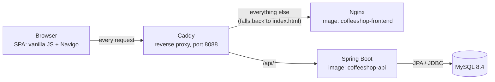

The browser sees one address for both pages and API, so Spring Boot needs no CORS configuration.

---

## 2. Packages and their relationships

All Java code lives under `ek.osnb.demo.coffeeshop`. There is one package per feature, plus `common`.

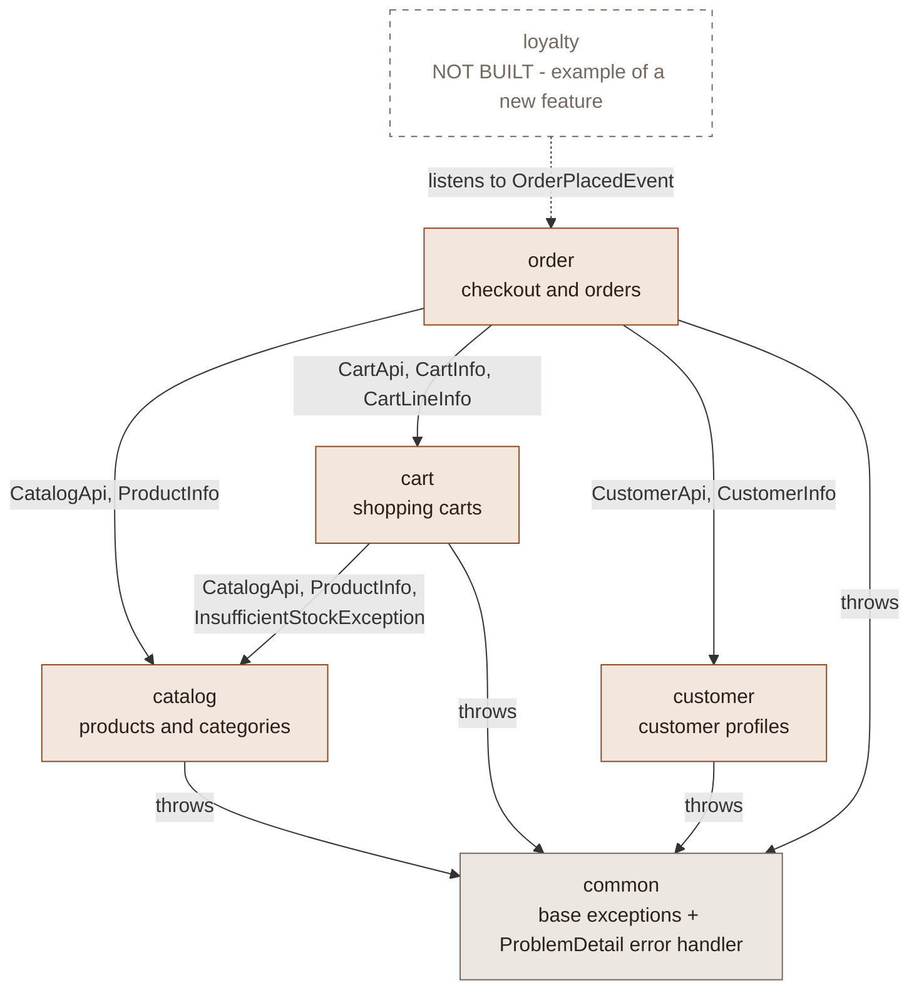

An arrow means "uses". The label says exactly which types are used. Only `CartService` and
`OrderService` cross a feature boundary, and only through these types.

### The public contract of each package

Every class is package-private except the ones below. `ArchitectureTest` checks this.

| Package | Public types (the contract) | Used by |
|---------|-----------------------------|---------|
| `catalog` | `CatalogApi`, `ProductInfo`, `InsufficientStockException` | `cart`, `order` |
| `customer` | `CustomerApi`, `CustomerInfo` | `order` |
| `cart` | `CartApi`, `CartInfo`, `CartLineInfo` | `order` |
| `order` | `OrderPlacedEvent` | nobody yet (an extension point) |
| `common` | `NotFoundException`, `ConflictException`, `InvalidInputException` | every feature |

### Rules shown by the diagram

- **Arrows point one way.** `catalog` and `customer` use no other feature, and nothing uses `order`,
  so there are no cycles.
- **Arrows end at a contract.** No arrow reaches an entity, repository or service in another package.
- **New features attach at the edge.** A future `loyalty` feature listens to `OrderPlacedEvent`.
  The order package doesn't change and doesn't know about it.

---

## 3. Inside each package

How to read the class diagrams:

| Notation | Meaning |
|----------|---------|
| `«public interface»`, `«public record»`, `«public»` | Part of the package's contract, usable from other packages |
| any other stereotype (`«Entity»`, `«Service»`, `«record»`, ...) | Package-private, so invisible outside the package |
| `+` method | public |
| `~` method | package-private |
| `-` field | private |
| `$` after a method | static |
| `A <|.. B` | B implements A |
| `A *-- B` | A owns B (JPA association inside the feature) |
| `A --> B` | A uses B |
| `A ..> B` | A creates, returns or throws B |
| a box in another namespace | a type from another package, i.e. a cross-package relationship |

### common

Base exceptions that every feature throws, and one handler that turns them into ProblemDetail
responses. `common` knows no feature: `InsufficientStockException` extends `ConflictException`, not
the other way round.

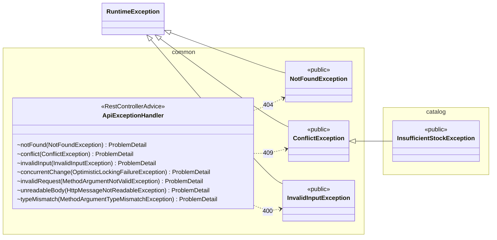

### catalog

Products and categories. It uses no other feature. Inside the package, `Product` has a JPA
association to `Category` (`@ManyToOne`), which is allowed because both belong to the catalog.

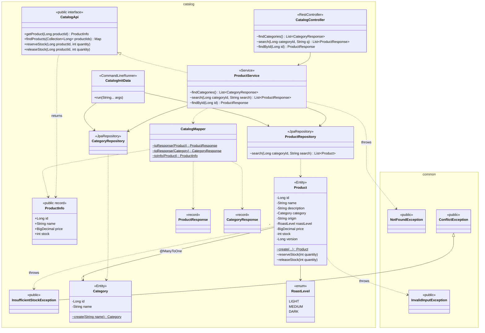

### customer

Customer profiles. It uses no other feature. Other features get a customer through
`CustomerApi.getCustomer(id)` as a `CustomerInfo` copy, never the `Customer` entity.

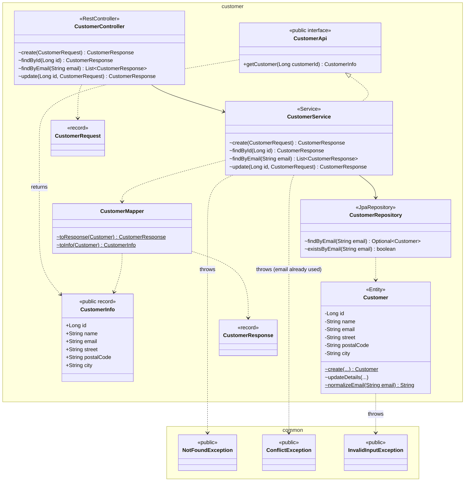

### cart

Shopping carts. **Uses `catalog`** through `CatalogApi`. `CartItem` only stores a `productId`.
Names, prices and stock are looked up live, with one `findProducts` call per cart.

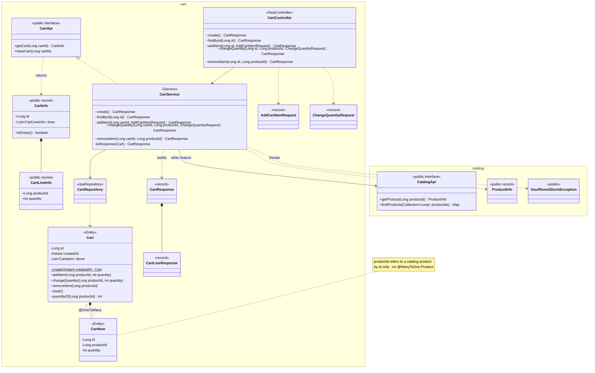

### order

Checkout and orders. **Uses `customer`, `cart` and `catalog`**, each through its `XxxApi`, and
publishes `OrderPlacedEvent` for features that don't exist yet. The order keeps *copies* of the
product names, prices and shipping address, so later changes elsewhere don't rewrite history.

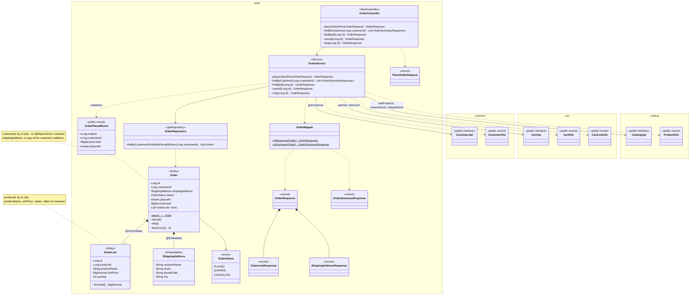

#### Order status

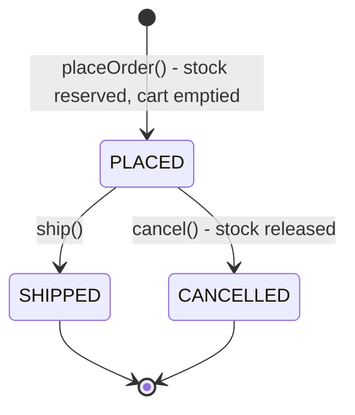

Any other transition throws `ConflictException`, which becomes a 409, e.g. cancelling a shipped order.

---

## 4. Database: foreign keys inside a feature, ids across

Hibernate creates the tables from the entities (`ddl-auto=update`).

- **Solid lines** are JPA associations inside one feature. They become real foreign keys.
- **Dashed lines** are id references to another feature. They are plain `BIGINT` columns with no
  foreign key, so the features stay independent and could even get their own databases later.

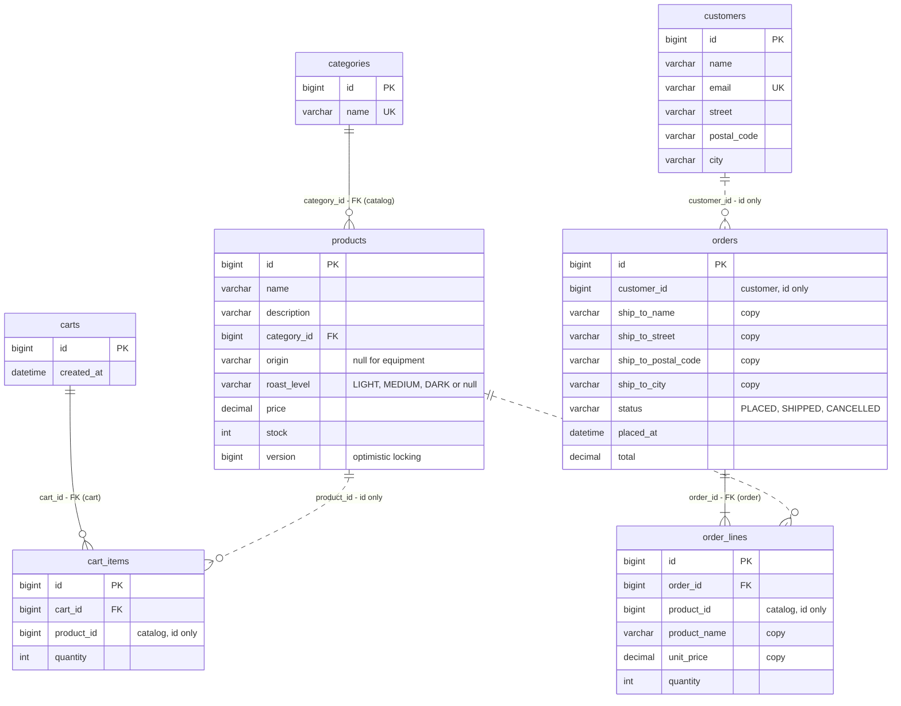

---

## 5. Checkout, step by step

What happens when the customer clicks **Place order**. The order feature talks to three other
features, always through their `XxxApi`. Everything inside `placeOrder` is one transaction.

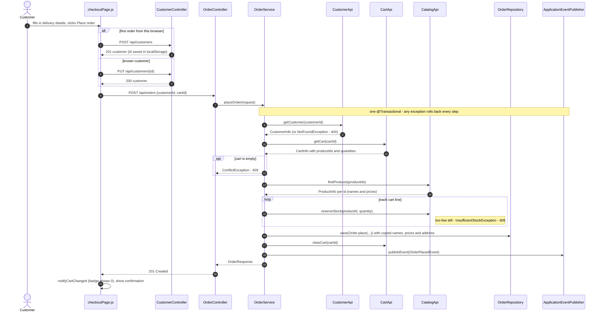

---

## 6. Frontend modules

The frontend is grouped by type, like the course template. Pages call the API and draw components.
Components never call the API themselves.

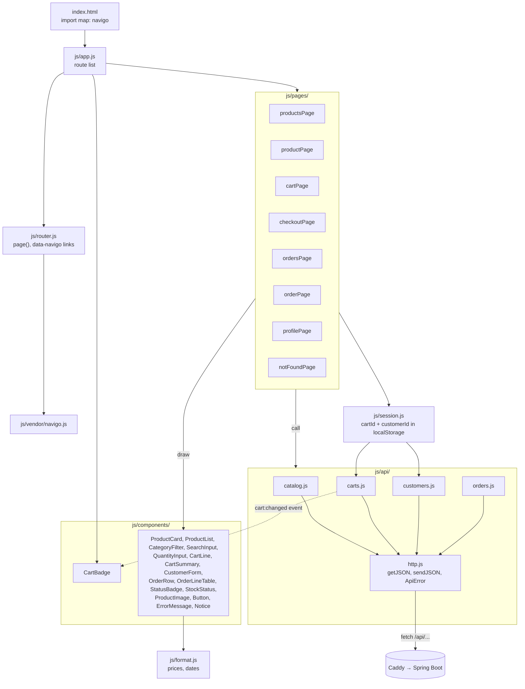

| Route | Page | Components | API calls |
|-------|------|------------|-----------|
| `/` | `productsPage.js` | CategoryFilter, SearchInput, ProductList → ProductCard (ProductImage, StockStatus, Button), ErrorMessage | `getCategories`, `getProducts`, `addToCart` |
| `/products/:id` | `productPage.js` | ProductImage, StockStatus, QuantityInput, Button, Notice, ErrorMessage | `getProduct`, `addToCart` |
| `/cart` | `cartPage.js` | CartLine (QuantityInput, Button), CartSummary, ErrorMessage | `getCart`, `changeQuantity`, `removeFromCart` |
| `/checkout` | `checkoutPage.js` | CustomerForm, CartSummary | `createCustomer` / `updateCustomer`, `placeOrder` |
| `/orders` | `ordersPage.js` | OrderRow (StatusBadge) | `getOrders` |
| `/orders/:id` | `orderPage.js` | OrderLineTable, StatusBadge, Button, ErrorMessage | `getOrder`, `cancelOrder` |
| `/profile` | `profilePage.js` | CustomerForm, Button, Notice, ErrorMessage | `getCustomer`, `findCustomerByEmail`, `createCustomer`, `updateCustomer` |
| anything else | `notFoundPage.js` | | |

---

## 7. Features: use cases and user stories

### Use cases

Mermaid has no use case diagram, so this is a flowchart in that style: actors on the left, use cases
(rounded) grouped by feature.

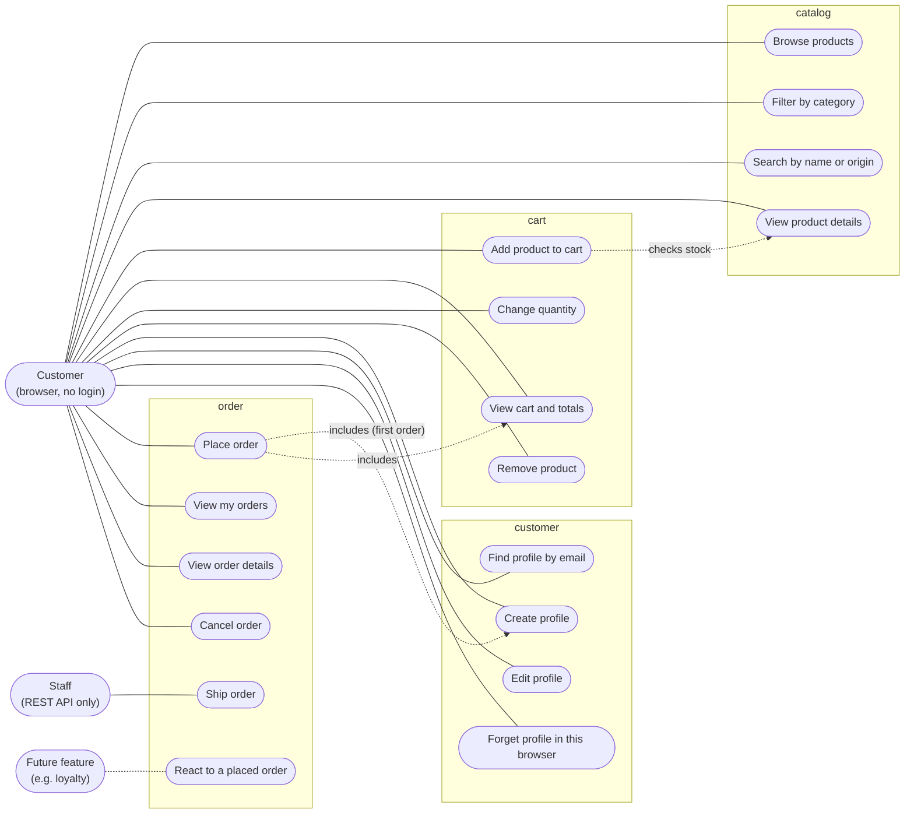

### User stories

All of these are implemented, in the REST API and (except US-17 and US-18) in the UI. The *Tests* column
names the tests that cover each story (`CheckoutFlowTest` unless another class is given).

#### Catalog

| ID | User story | Acceptance criteria | Where | Tests |
|----|-----------|---------------------|-------|-------|
| US-01 | As a **customer** I want to **see all products** so that I can choose what to buy. | Each product shows category, name, origin and roast (if coffee), price in DKK and stock status ("In stock", "Only 3 left", "Out of stock"). Sold-out products can't be added. | `/` · `GET /api/products` | `catalogIsFilledWithCategoriesAndProducts` |
| US-02 | As a **customer** I want to **filter by category** so that I only see beans, ground coffee or equipment. | "All" plus one button per category. The chosen one is highlighted. | `/` · `GET /api/categories`, `GET /api/products?categoryId=` | `productsCanBeFilteredByCategory` |
| US-03 | As a **customer** I want to **search by name or origin** so that I find e.g. all Kenyan coffee. | Case-insensitive. Combines with the category filter. Shows a message when nothing matches. | `/` · `GET /api/products?q=` | `productsCanBeSearchedByNameOrOrigin` |
| US-04 | As a **customer** I want to **see a product's details** so that I know what I'm buying. | Description, price and stock. Quantity can be chosen up to the stock (max 99). An unknown product shows "does not exist". | `/products/:id` · `GET /api/products/{id}` | `unknownProductReturns404AsProblemDetail` |

#### Cart

| ID | User story | Acceptance criteria | Where | Tests |
|----|-----------|---------------------|-------|-------|
| US-05 | As a **customer** I want to **add products to a cart** so that I can buy several things at once. | A cart is created on the first add and remembered by the browser. Adding the same product again increases its quantity. More than the stock gives "Only N left of ..." (409). | `/`, `/products/:id` · `POST /api/carts`, `POST /api/carts/{id}/items` | `addingMoreToTheCartThanInStockReturns409`, `CartTest`, `CartServiceTest` |
| US-06 | As a **customer** I want to **see my cart with totals** so that I know what I'll pay. | Lines show today's price, line total and quantity. The summary shows the item count and total. The header badge shows the item count on every page and survives a reload. | `/cart` · `GET /api/carts/{id}` | `fullCheckoutFlow`, `CartServiceTest` |
| US-07 | As a **customer** I want to **change the quantity** of a product in my cart. | 1-99 and at most the stock. A warning appears if the stock dropped below the quantity in the cart. | `/cart` · `PUT /api/carts/{id}/items/{productId}` | `CartTest` |
| US-08 | As a **customer** I want to **remove a product** from my cart. | The line disappears and the totals update. The empty cart links back to the shop. | `/cart` · `DELETE /api/carts/{id}/items/{productId}` | `CartTest` |

#### Customer

| ID | User story | Acceptance criteria | Where | Tests |
|----|-----------|---------------------|-------|-------|
| US-09 | As a **new customer** I want to **enter my name, email and address** so that my order can be delivered. | Done at checkout or on the profile page. Every field is required, and the email must be valid: errors are shown next to the field (400). One profile per email (409). | `/checkout`, `/profile` · `POST /api/customers` | `invalidCustomerReturns400WithAnErrorPerField`, `sameEmailCannotBeUsedTwice` |
| US-10 | As a **returning customer** I want to **find my profile by my email** so that I can use it in a new browser. | Case-insensitive. Shows "No customer has that email" if unknown. *Stand-in for a login.* | `/profile` · `GET /api/customers?email=` | `customerCanBeFoundByEmail` |
| US-11 | As a **customer** I want to **edit my details** so that future orders go to my new address. | Saved details show a confirmation. Existing orders keep the old address. | `/profile`, `/checkout` · `PUT /api/customers/{id}` | `OrderServiceTest` (address copied) |
| US-12 | As a **customer on a shared computer** I want to **forget my profile in this browser**. | The profile is removed from `localStorage`. "My orders" is empty again. The data on the server stays. | `/profile` | - |

#### Orders

| ID | User story | Acceptance criteria | Where | Tests |
|----|-----------|---------------------|-------|-------|
| US-13 | As a **customer** I want to **place an order from my cart** so that I get my coffee. | The stock is reserved and the cart is emptied, and a confirmation with the order number is shown. Names, prices and address are copied into the order. If any product is short on stock, nothing changes (409). An empty cart can't be ordered (409). | `/checkout` · `POST /api/orders` | `fullCheckoutFlow`, `whenStockRunsOutBeforeCheckoutNothingIsChanged`, `emptyCartCannotBeOrdered`, `OrderServiceTest` |
| US-14 | As a **customer** I want to **see my orders** so that I can keep track of them. | Newest first, each with number, date, item count, status and total. | `/orders` · `GET /api/orders?customerId=` | `fullCheckoutFlow` |
| US-15 | As a **customer** I want to **see an order's details**. | Lines with the prices paid, the shipping address and the status. Works as a direct link. | `/orders/:id` · `GET /api/orders/{id}` | `fullCheckoutFlow` |
| US-16 | As a **customer** I want to **cancel an order that hasn't shipped** so that I don't pay for something I no longer want. | Only PLACED orders. The items go back in stock. A second cancel gives 409. | `/orders/:id` · `POST /api/orders/{id}/cancel` | `fullCheckoutFlow`, `OrderTest`, `OrderServiceTest` |
| US-17 | As **staff** I want to **mark an order as shipped**. | Only PLACED orders. A shipped order can no longer be cancelled. *API only. Should require a staff login later.* | `POST /api/orders/{id}/ship` | `shippedOrderCannotBeCancelled`, `OrderTest` |
| US-18 | As a **developer of a new feature** I want to **be told when an order is placed** so that I can react without changing the order code. | `OrderPlacedEvent` (order id, customer id, total, time) is published at checkout. | `OrderService` | `fullCheckoutFlow`, `OrderServiceTest` |

### Not built yet

Ideas for the next features are listed in the README under [Feature ideas](README.md#feature-ideas):
login with Spring Security, reviews, wishlist, discount codes, loyalty points (via US-18),
product management and AI recommendations.
