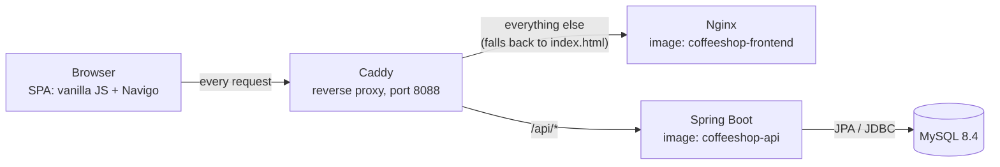
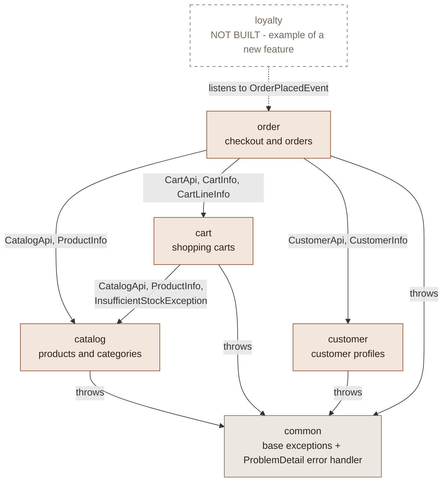
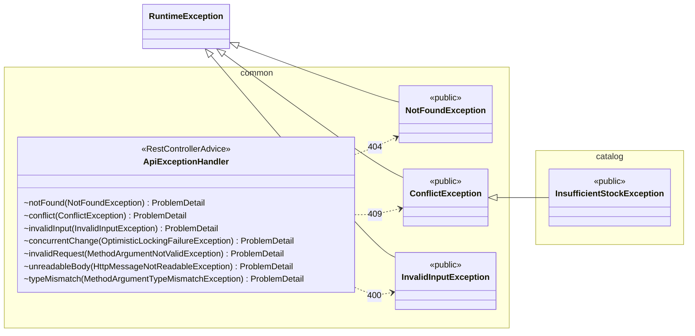
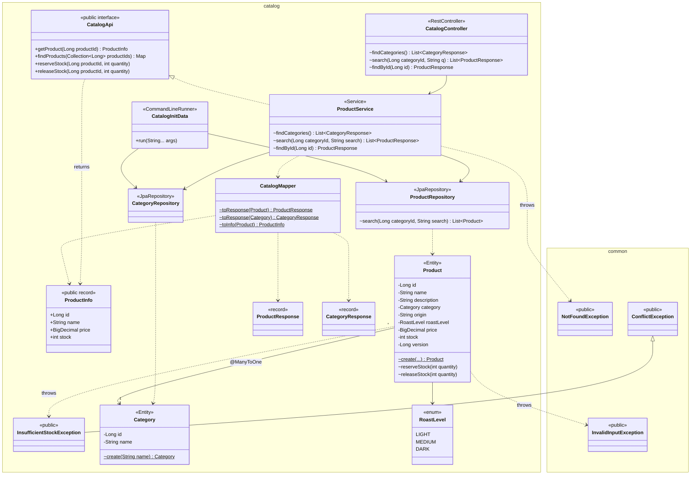
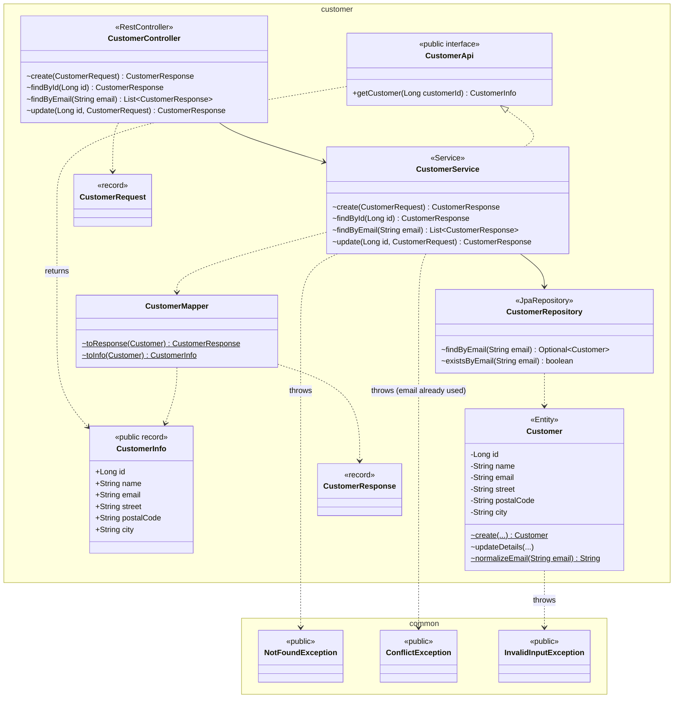
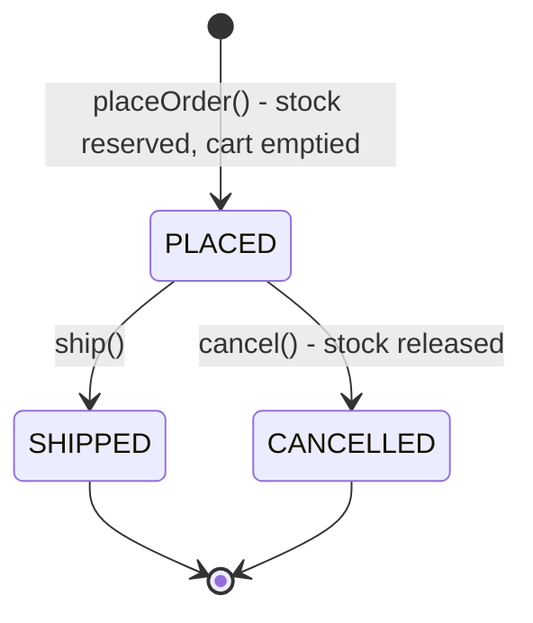
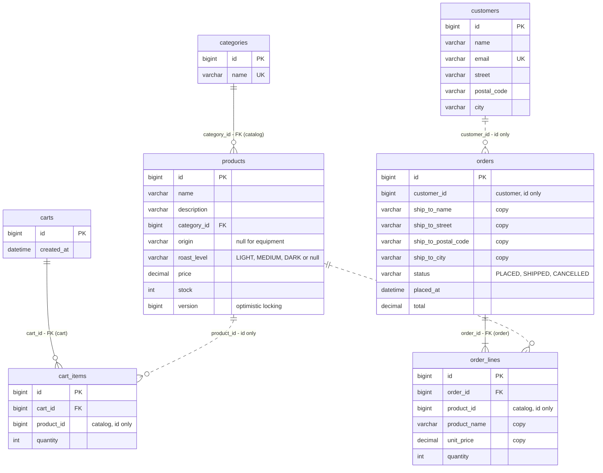
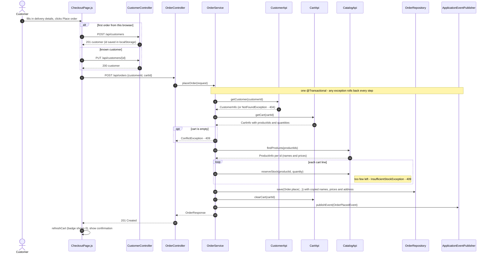
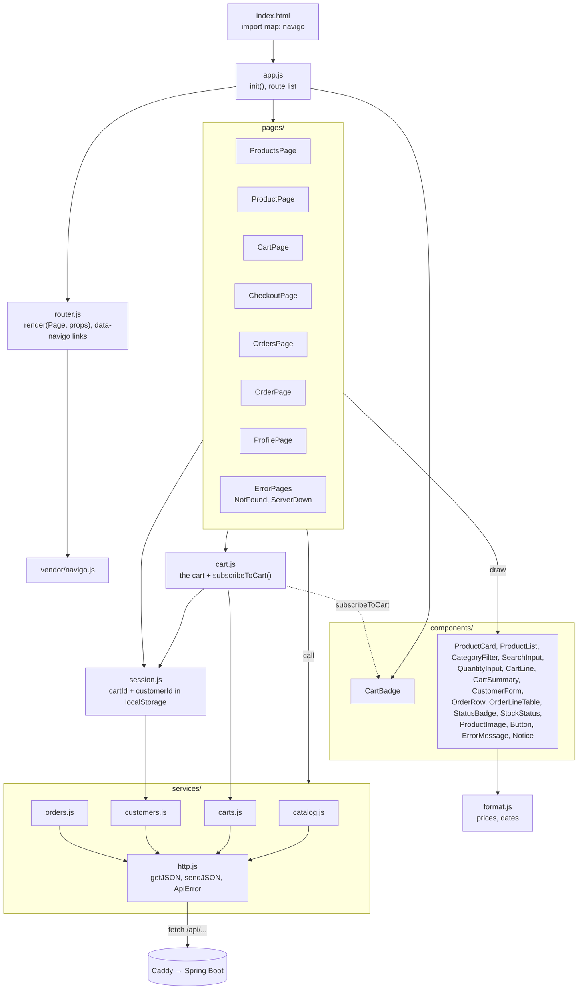

# Coffee Shop: architecture and features

Diagrams of how the code is organised and what the app can do. The [README](README.md) explains
how to run it and how to add a feature.

GitHub, GitLab and IntelliJ (with the Mermaid plugin) render the diagrams below.

## Contents

1. [Runtime: the parts and how they talk](#1-runtime-the-parts-and-how-they-talk)
2. [Packages and their relationships](#2-packages-and-their-relationships)
3. [Inside each package](#3-inside-each-package)
   - [common](#common)
   - [catalog](#catalog)
   - [customer](#customer)
   - [cart](#cart)
   - [order](#order)
4. [Database: foreign keys inside a feature, ids across](#4-database-foreign-keys-inside-a-feature-ids-across)
5. [Checkout, step by step](#5-checkout-step-by-step)
6. [Frontend modules](#6-frontend-modules)
7. [Not built yet](#not-built-yet)

---

## 1. Runtime: the parts and how they talk

The browser sees one address for both pages and API, so Spring Boot needs no CORS configuration.

---

## 2. Packages and their relationships

All Java code lives under `ek.osnb.demo.coffeeshop`. There is one package per feature, plus `common`.

An arrow means "uses". The label says exactly which types are used. Only `CartService` and
`OrderService` cross a feature boundary, and only through these types.

### The public contract of each package

Every class is package-private except the ones below. `ArchitectureTest` checks this.

| Package | Public types (the contract) | Used by |
|---------|-----------------------------|---------|
| `catalog` | `CatalogApi`, `ProductInfo`, `InsufficientStockException` | `cart`, `order` |
| `customer` | `CustomerApi`, `CustomerInfo` | `order` |
| `cart` | `CartApi`, `CartInfo`, `CartLineInfo` | `order` |
| `order` | `OrderPlacedEvent` | nobody yet (an extension point) |
| `common` | `NotFoundException`, `ConflictException`, `InvalidInputException` | every feature |

### Rules shown by the diagram

- **Arrows point one way.** `catalog` and `customer` use no other feature, and nothing uses `order`,
  so there are no cycles.
- **Arrows end at a contract.** No arrow reaches an entity, repository or service in another package.
- **New features attach at the edge.** A future `loyalty` feature listens to `OrderPlacedEvent`.
  The order package doesn't change and doesn't know about it.

---

## 3. Inside each package

How to read the class diagrams:

| Notation | Meaning |
|----------|---------|
| `«public interface»`, `«public record»`, `«public»` | Part of the package's contract, usable from other packages |
| any other stereotype (`«Entity»`, `«Service»`, `«record»`, ...) | Package-private, so invisible outside the package |
| `+` method | public |
| `~` method | package-private |
| `-` field | private |
| `$` after a method | static |
| `A <|.. B` | B implements A |
| `A *-- B` | A owns B (JPA association inside the feature) |
| `A --> B` | A uses B |
| `A ..> B` | A creates, returns or throws B |
| a box in another namespace | a type from another package, i.e. a cross-package relationship |

### common

Base exceptions that every feature throws, and one handler that turns them into ProblemDetail
responses. `common` knows no feature: `InsufficientStockException` extends `ConflictException`, not
the other way round.

### catalog

Products and categories. It uses no other feature. Inside the package, `Product` has a JPA
association to `Category` (`@ManyToOne`), which is allowed because both belong to the catalog.

### customer

Customer profiles. It uses no other feature. Other features get a customer through
`CustomerApi.getCustomer(id)` as a `CustomerInfo` copy, never the `Customer` entity.

### cart

Shopping carts. **Uses `catalog`** through `CatalogApi`. `CartItem` only stores a `productId`.
Names, prices and stock are looked up live, with one `findProducts` call per cart.

### order

Checkout and orders. **Uses `customer`, `cart` and `catalog`**, each through its `XxxApi`, and
publishes `OrderPlacedEvent` for features that don't exist yet. The order keeps *copies* of the
product names, prices and shipping address, so later changes elsewhere don't rewrite history.

#### Order status

Any other transition throws `ConflictException`, which becomes a 409, e.g. cancelling a shipped order.

---

## 4. Database: foreign keys inside a feature, ids across

Hibernate creates the tables from the entities (`ddl-auto=update`).

- **Solid lines** are JPA associations inside one feature. They become real foreign keys.
- **Dashed lines** are id references to another feature. They are plain `BIGINT` columns with no
  foreign key, so the features stay independent and could even get their own databases later.

---

## 5. Checkout, step by step

What happens when the customer clicks **Place order**. The order feature talks to three other
features, always through their `XxxApi`. Everything inside `placeOrder` is one transaction.

---

## 6. Frontend modules

The frontend is grouped by type, with the same structure as the other course demos: `app.js` lists
the routes, `router.js` renders one page at a time, and shared state (the cart) lives in its own module.
Pages call the API and draw components. Components never call the API themselves.

| Route | Page | Components | Calls (`services/`, or `cart.js` for the cart) |
|-------|------|------------|-----------|
| `/` | `ProductsPage.js` | CategoryFilter, SearchInput, ProductList → ProductCard (ProductImage, StockStatus, Button), ErrorMessage | `getCategories`, `getProducts`, `addToCart` |
| `/products/:id` | `ProductPage.js` | ProductImage, StockStatus, QuantityInput, Button, Notice, ErrorMessage | `getProduct`, `addToCart` |
| `/cart` | `CartPage.js` | CartLine (QuantityInput, Button), CartSummary, ErrorMessage | `refreshCart`, `changeQuantity`, `removeFromCart` |
| `/checkout` | `CheckoutPage.js` | CustomerForm, CartSummary | `refreshCart`, `createCustomer` / `updateCustomer`, `placeOrder` |
| `/orders` | `OrdersPage.js` | OrderRow (StatusBadge) | `getOrders` |
| `/orders/:id` | `OrderPage.js` | OrderLineTable, StatusBadge, Button, ErrorMessage | `getOrder`, `cancelOrder` |
| `/profile` | `ProfilePage.js` | CustomerForm, Button, Notice, ErrorMessage | `getCustomer`, `findCustomerByEmail`, `createCustomer`, `updateCustomer` |
| anything else | `NotFoundPage` in `ErrorPages.js` | | |
| (API down at startup) | `ServerDownPage` in `ErrorPages.js` | | `refreshCart` failed in `app.js` |

---

## Not built yet

Ideas for the next features: login with Spring Security, reviews, wishlist, discount codes,
loyalty points (via `OrderPlacedEvent`), product management and AI recommendations. The README
explains [how to add a feature](README.md#adding-a-feature).
