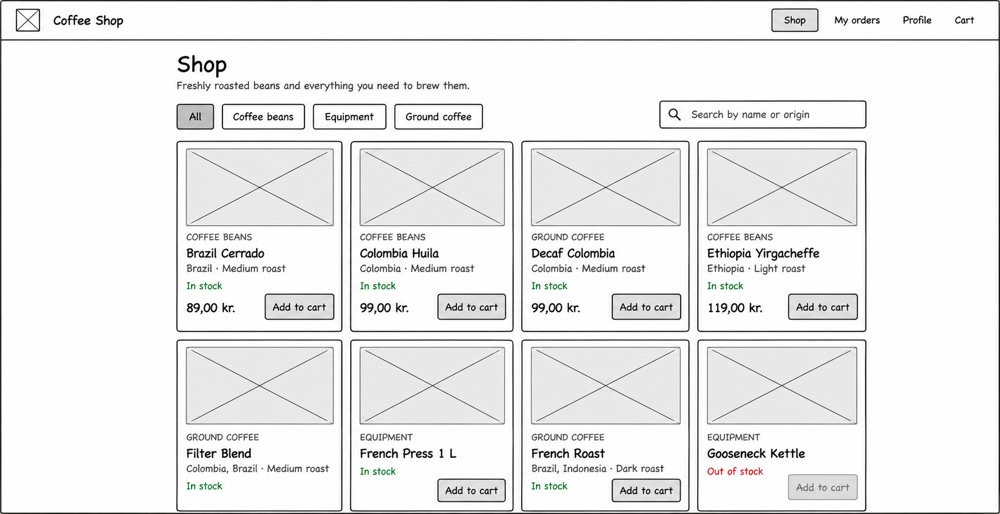

# Requirements: online coffee shop

> It would be a short brief from the shop owner, written in business language. It has no screens, endpoints or user stories, only what the business
needs and the rules it works by. Here is an example that covers what the reference app already does, so your US-01 to US-18 can serve as the answer
key.

---

From: the owner of a small Copenhagen roastery
Background: We sell coffee beans, ground coffee and brewing equipment in our shop. We now want to sell online too. We have no online shop or IT system
today.

## Goals

- Customers can find and buy our products online, from a phone or a computer.
- We never sell more than we have in stock.
- We can see and handle the orders that come in.

## Who will use it

- Customers: private people buying coffee. We don't want passwords for now. We recognise customers by their email address.
- Staff: the people who pack and send orders.

## What we need

### Our products
- R1 We sell three kinds of products: coffee beans, ground coffee and equipment. Customers must be able to browse each kind on its own.
- R2 Customers often ask for a specific origin, such as "something from Ethiopia", or a product by name. They must be able to search.
- R3 For coffee, customers care about the origin and the roast level. Every product shows its price in Danish kroner and whether it is in stock.
- R4 When we only have a few left of a product, customers should be told, so they buy before it runs out.

### The basket
- R5 Customers collect products in a basket and choose how many of each they want. They can change the number or remove a product again.
- R6 If a customer closes the browser and comes back on the same device, the basket must still be there.
- R7 Customers cannot put more of a product in the basket than we have in stock. Nobody may buy more than 99 of one product.
- R8 The basket always shows today's prices. The price at the moment of ordering is what the customer pays.

### Customer details
- R9 To send an order, we need the customer's name, email and delivery address.
- R10 One email address belongs to one customer.
- R11 Returning customers should not have to type their details again, and they must be able to update them.

### Ordering
- R12 An order covers the whole basket. If we can't deliver everything, nothing is ordered and the customer is told why. We never send part of an
  order.
- R13 After ordering, the basket is empty. The customer sees a confirmation with an order number, the items and the total.
- R14 An old order must always show what the customer paid and where it was sent, even if we later change a price, rename a product or the customer
  moves.
- R15 Customers can see their earlier orders, newest first.
- R16 Customers can cancel an order until it has been sent. The products then go back into stock.

### Staff
- R17 Staff mark an order as sent. A sent order cannot be cancelled. A staff screen can come later; for now our developer can do this for us.

### Later
- R18 We want to reward customers with loyalty points for their orders next year. Please build things so this can be added without rebuilding the
  checkout.

## Not included now

Payment, logins and passwords, shipping costs, discount codes, staff managing products, and order confirmation emails.

### Technical requirements (from the course, not the business)

- Spring Boot with JPA and MySQL.
- A separate vanilla-JS single-page app.
- Everything runs in Docker.
- Organised by feature; features refer to each other by id only.

---

How the students would use it

1. Find the actors and goals. The brief names two actors (customer and staff) plus a future one (loyalty).
2. Turn requirements into stories. One requirement can become several stories, and one story can cover more than one requirement. For example:
   - R5 becomes three stories: add to basket, change quantity, remove.
   - R2 and R1 could become one story.
3. Turn the rules into acceptance criteria. R7, R12, R14 and R16 are written as rules on purpose, so they become testable criteria rather than
   stories.
4. Find the gaps and ask the product owner, which is you.

It's worth leaving a few things vague on purpose, so students have to ask:
- How many is "only a few left"? (The app uses ≤ 5.)
- What happens if a product runs out while it's in someone's basket?
- Should a customer be able to see someone else's orders?

Your US-01 to US-18 can be the answer key, but the numbers won't match the R numbers one for one. To save this as REQUIREMENTS.md with a table mapping
each requirement to its user stories, ask in the main conversation. I can't create files or check the story numbering from here.
